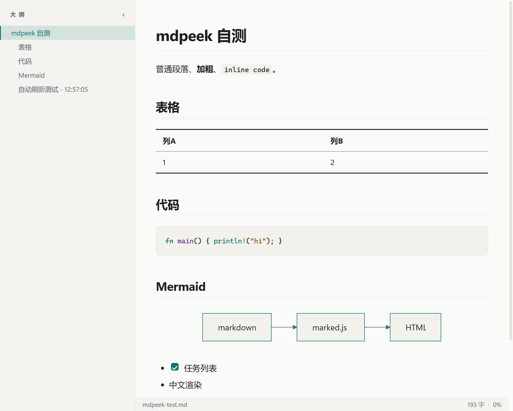
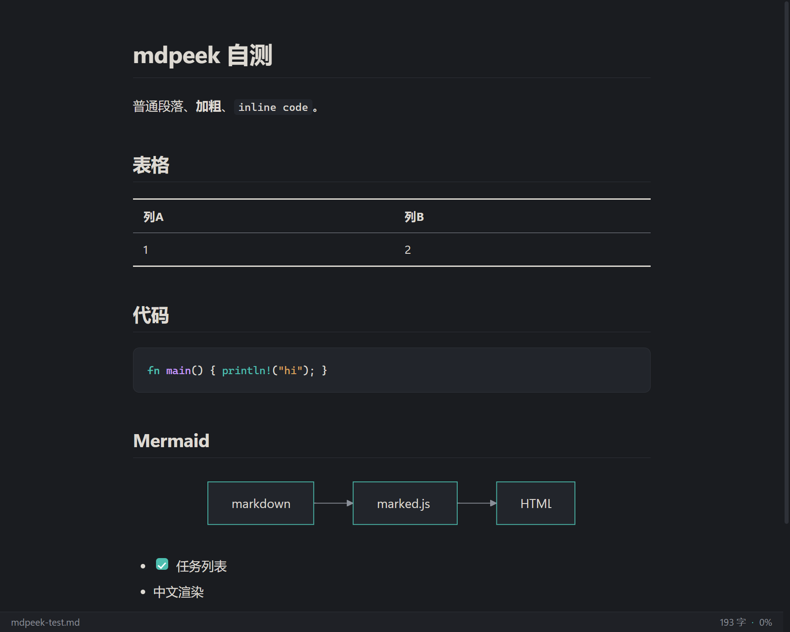

# mdpeek

A tiny, fast Markdown viewer for Windows — Notepad-simple on the outside, full rendering on the inside.

[中文说明](README.zh-CN.md)




## Features

- GFM rendering: headings, tables, task lists, strikethrough, links, images
- Mermaid diagrams rendered from ` ```mermaid ` code blocks
- Syntax highlighting via highlight.js
- Light / dark theme that follows the system, one key to toggle
- Live reload — the view refreshes itself when the file changes on disk (pair it with Notepad for a zero-friction edit + preview loop)
- Outline sidebar with scroll-spy highlighting
- Source view: peek at the raw Markdown with one key
- Always-on-top, zoom, print / export to PDF, custom context menu
- Single ~5 MB exe, no installer, no Electron — Rust + system WebView2

## Usage

```
mdpeek.exe path\to\file.md
```

Or just drag a `.md` file onto the window.

## Keyboard & menu

Everything is also in the right-click menu.

| Key | Action |
|---|---|
| `O` | Toggle outline sidebar |
| `S` | Toggle Markdown source view |
| `E` | Open file in Notepad (edits live-reload the preview) |
| `B` | Reveal file in Explorer |
| `R` | Reload file |
| `T` | Toggle light / dark theme |
| `Ctrl + wheel` | Zoom (menu: reset to 100%) |
| `Ctrl + P` | Print / export to PDF |

## Build

```
cargo build --release
```

Output: `target\release\mdpeek.exe` — a single self-contained binary. Requires the WebView2 runtime (preinstalled on Windows 10/11).

## Stack

Rust · [wry](https://github.com/tauri-apps/wry) + [tao](https://github.com/tauri-apps/tao) · WebView2 · marked · mermaid · highlight.js

## License

MIT — see [LICENSE](LICENSE).
