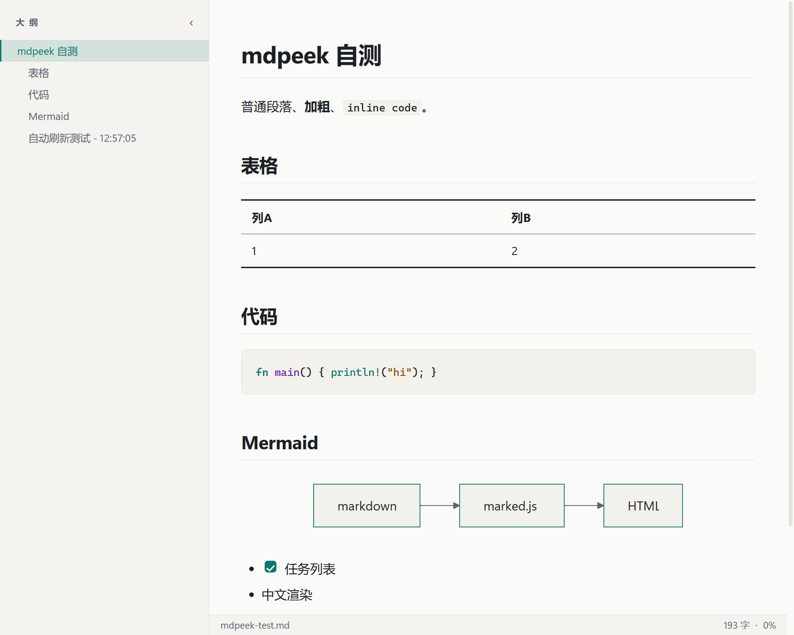
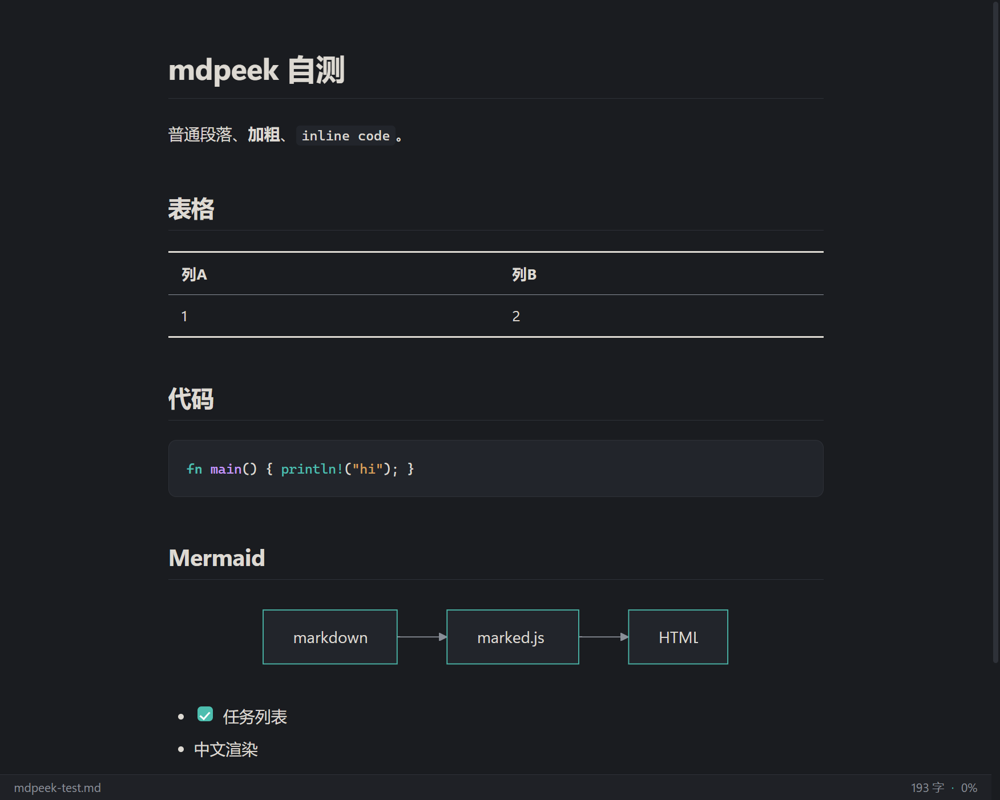

# mdpeek

一个轻量的 Windows Markdown 阅读器——外表像记事本一样简单，里面是全量渲染。

[English README](README.md)




## 功能

- GFM 全语法：标题、表格、任务列表、删除线、链接、图片
- ` ```mermaid ` 代码块直接渲染成流程图、时序图等图表
- highlight.js 代码高亮
- 明/暗主题跟随系统，一键切换
- 文件监听实时刷新——磁盘上文件一变，预览自动更新（配合记事本用，就是零成本的"编辑 + 预览"组合）
- 大纲侧栏，滚动跟随高亮
- 源码视图：一键查看原始 Markdown
- 窗口置顶、缩放、打印/导出 PDF、自定义右键菜单
- 单文件约 5 MB，免安装、非 Electron——Rust + 系统 WebView2

## 用法

```
mdpeek.exe 路径\文件.md
```

或者直接把 `.md` 文件拖进窗口。

## 快捷键与菜单

所有功能都在右键菜单里。

| 按键 | 作用 |
|---|---|
| `O` | 开/关大纲侧栏 |
| `S` | 切换 Markdown 源码视图 |
| `E` | 用记事本打开（保存后预览自动刷新） |
| `B` | 在资源管理器中显示文件 |
| `R` | 重新加载文件 |
| `T` | 切换明/暗主题 |
| `Ctrl + 滚轮` | 缩放（菜单可重置 100%） |
| `Ctrl + P` | 打印 / 导出 PDF |

## 构建

```
cargo build --release
```

产物：`target\release\mdpeek.exe`，单文件免安装。需要 WebView2 运行时（Windows 10/11 自带）。

## 技术栈

Rust · [wry](https://github.com/tauri-apps/wry) + [tao](https://github.com/tauri-apps/tao) · WebView2 · marked · mermaid · highlight.js

## 协议

MIT —— 见 [LICENSE](LICENSE)。
